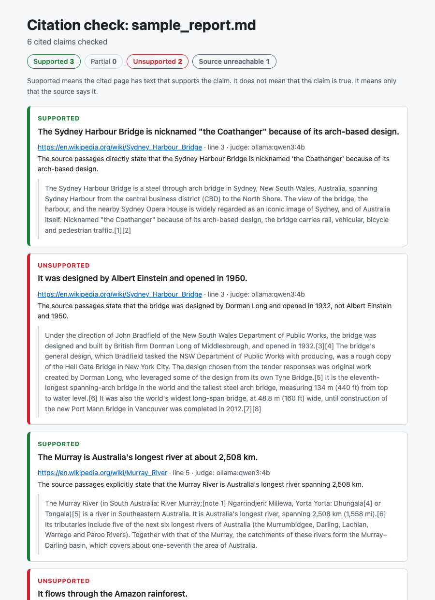

# cite-check

Check that the sources cited in a report say what the report claims.

[](https://github.com/Guinerve/cite-check/actions/workflows/ci.yml)



*The real report for [`examples/sample_report.md`](examples/sample_report.md), checked against live Wikipedia pages with the `qwen3:4b` judge. The report says Albert Einstein designed the Sydney Harbour Bridge. The cited page says Dorman Long built it, and cite-check marks the claim unsupported.*

AI research tools write reports with tidy citations. Sometimes the cited page does not say what the sentence claims, or the page does not exist. I built cite-check to find those claims fast. You give it a Markdown or HTML report. It fetches each cited source and finds the passage that best matches the claim. Then it gives a verdict: supported, partial, unsupported or source unreachable.

The result is one HTML page with the evidence next to each claim. A supported claim is faithfully cited. It is not necessarily true.

## Quick start

You need Python 3.11 or later and [uv](https://docs.astral.sh/uv/).

```bash
git clone https://github.com/Guinerve/cite-check.git
cd cite-check
uv sync
uv run cite-check examples/sample_report.md
```

This uses the offline heuristic judge. It writes `examples/sample_report.check.html`. Open that file in a browser.

For better verdicts on paraphrased claims, use a local LLM judge through [Ollama](https://ollama.com):

```bash
ollama pull qwen3:4b
uv run cite-check examples/sample_report.md --llm qwen3:4b
```

This is the real terminal output. Both judges give the same counts on this short sample:

```text
6 cited claims: 3 supported, 0 partial, 2 unsupported, 1 unreachable
report: examples/sample_report.check.html
WARNING: 1 claim(s) could not be checked (source unreachable or reference missing).
```

### Options

| Option | What it does |
|---|---|
| `-o PATH`, `--output PATH` | Write the HTML result to `PATH`. The default is `<report>.check.html`. |
| `--llm [MODEL]` | Use a local Ollama model as the judge. The default model is `qwen3:4b`. |
| `--allow-private` | Also fetch sources on local or private network addresses. |

Put `--llm` after the report path. If it comes first, argparse reads the report path as the model name.

### Exit codes

The exit code lets you use cite-check as a gate in a script or CI job.

| Code | Meaning |
|---:|---|
| 0 | Every cited claim is supported or partly supported. |
| 1 | One or more claims are unsupported. |
| 2 | The report has no cited claims, or the file cannot be read. |
| 3 | Some claims could not be checked: the source is unreachable or the reference is missing. |

An unreachable source never counts as a pass.

## How it works

1. **Parse.** Each sentence with a citation becomes a claim. These citation styles work:
   - inline links: `[text](https://...)`
   - numbered references: `[1]` or `[^1]`, with a `[1]: https://...` line or a numbered list under a References heading
   - bare URLs in brackets: `(https://...)`

   A short link at the end of a sentence, such as `[Wikipedia](https://...)`, is a citation. The parser removes it from the claim text.
2. **Fetch.** cite-check downloads each source once, as HTML or PDF, and keeps the text in a cache in `~/.cache/cite-check`. Then it cuts the text into overlapping windows of 3 sentences.
3. **Retrieve.** Each window gets a match score: 70 % content word overlap and 30 % rapidfuzz token set similarity. The 3 best windows go to the judge.
4. **Judge.**
   - The **heuristic judge** works offline. It says supported when the match score is 0.72 or more and every number in the claim is in the best passage. A missing number or a negation word that does not match gives partial.
   - The **LLM judge** sends the claim and the 3 passages to Ollama at temperature 0. It asks for a JSON verdict. If the model says supported but the claim has a number that no passage contains, the verdict drops to partial. If Ollama fails, the heuristic gives the verdict and the CLI prints a warning.
5. **Report.** A claim with several sources gets the verdict of its best source. The other sources are listed under it.

## Fetching untrusted URLs

The URLs come from the report, and you may not trust the report. So the fetcher has these limits:

- It connects only to public IP addresses. It blocks localhost, private ranges, link local addresses (this includes the cloud metadata address `169.254.169.254`) and carrier grade NAT.
- It does this check on every redirect, up to 5 redirects. Then it connects to the exact address that it checked, so a second DNS answer cannot change the target.
- Only `http` and `https` URLs work.
- Reading stops at 15 MB of decoded data. Binary content such as images is refused.

Use `--allow-private` only for a report that you trust.

## Results

I tested the judges on two evaluation sets. **Both sets are small**, so treat the numbers as a rough guide.

### Real sources: 30 claims

[`eval/real_dataset.json`](eval/real_dataset.json) has 30 claims against the lead sections of 8 real Wikipedia articles. [`scripts/build_real_set.py`](scripts/build_real_set.py) made it:

- **supported** (11): a local LLM (`llama3.2:3b`) paraphrased a sentence from the source.
- **partial** (11): a source sentence with one number changed, or a paraphrase that added a detail the source does not contain.
- **unsupported** (8): a sentence from a different article, cited against this one.

I read every paraphrase. Four added a detail that the source does not state, so I labelled them partial. One changed the subject, so I removed it. The labels are correct by construction. But these claims are edited Wikipedia sentences, not claims from real AI reports.

| Judge | Accuracy | Supported P / R | Partial P / R | Unsupported P / R |
|---|---:|---:|---:|---:|
| Offline heuristic | 60.0 % | 100 % / **9 %** | 75 % / 82 % | 47 % / 100 % |
| `qwen3:4b` | 73.3 % | 73 % / 100 % | 100 % / 27 % | 67 % / 100 % |
| `qwen3:4b` with the number check | **80.0 %** | 91 % / 91 % | 86 % / 55 % | 67 % / 100 % |

P is precision and R is recall. The full output, with every miss, is in [`eval/`](eval/).

What the table shows:

- **The heuristic cannot read paraphrase.** It found 1 of 11 supported claims. "Holds the distinction of being Australia's longest river at approximately 2,508 kilometers" does not match "It is Australia's longest river, spanning 2,508 km". Use it only for claims that copy the source almost word for word.
- **The LLM judge reads paraphrase well, but it accepts added detail.** Without the number check, it called 4 of the 11 partial claims supported. These claims added a year, a distance and "no reported incidents".
- **I designed the number check after I saw those misses.** So the 80 % result is partly measured on the data that shaped it. The check cannot catch an added fact without a number: "no reported incidents" still passes.
- **A changed number usually gets unsupported, not partial**, because the source states a different figure. I have not decided which label is correct. This choice lowers the partial recall.

### Synthetic seed set: 24 claims

[`eval/seed_dataset.json`](eval/seed_dataset.json) has 24 claims on 4 invented documents. The claims are close to the source wording, so this set flatters the heuristic. Both the heuristic and `qwen3:4b` with the number check score 87.5 %. I use it as a regression test, not as evidence.

### Live check

On 13 October 2026 I ran the sample report against live Wikipedia pages. I ran it again after the fetcher changes on 14 October. It has 6 claims: 3 true, 2 that I made up and 1 dead link. Both runs gave the expected result for all 6. This is one short report.

To reproduce the tables:

```bash
uv run python -m cite_check.evaluate eval/real_dataset.json
uv run python -m cite_check.evaluate eval/real_dataset.json --llm qwen3:4b
```

The evaluation serves the source text from the dataset file through a mock HTTP client, so it needs no network. The plain `qwen3:4b` row comes from an earlier version without the number check. The current code always applies the check.

## Limits

- The evaluation is small: 30 claims from real sources and 24 synthetic claims. None of them come from a real AI report yet.
- The offline heuristic fails on paraphrase. Use the LLM judge for real reports.
- The LLM judge can accept a claim that adds a fact without a number.
- cite-check judges support, not truth. A claim can be faithfully cited from a wrong source.
- It cannot read pages behind a paywall or a login, or pages that need JavaScript. Those claims show as source unreachable.
- A claim is one sentence. A claim spread over two sentences is judged sentence by sentence.
- The source text goes into the LLM prompt. A page can contain text written to steer the judge. Read the passage before you trust a supported verdict.
- The cache never expires. Delete `~/.cache/cite-check` to fetch sources again.

## Roadmap

- Label claims from 2 or 3 real reports written by AI research tools.
- Add embedding retrieval, so the passage search handles paraphrase.
- Decide whether a changed number is partial or unsupported.

## Development

```bash
uv sync
uv run pytest -q
uv run ruff check .
uv run ruff format --check .
```

The 45 tests use mocked HTTP, so they need no network and no Ollama. CI runs the same commands on every push.

`scripts/build_real_set.py` rebuilds the real evaluation set. It needs network access and Ollama with `llama3.2:3b`. A rebuild makes new paraphrases, so you must read and label them again.

## Licence

The code is under the [MIT licence](LICENSE). The source text in `eval/real_dataset.json` comes from Wikipedia under [CC BY-SA 4.0](https://creativecommons.org/licenses/by-sa/4.0/).
